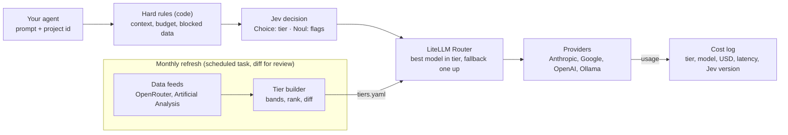

# Token-Aware Model Router — Research, Design & Phase 1

Oct 14, 2026 · Maneesh

## Recommendation

**Extend, don't build from scratch.** No single repo does all three jobs we need, but two pieces cover most of it: LiteLLM for calling 100+ models with fallbacks and cost tracking, and Jev for the per-request tier decision. We build only the thin glue in the middle.

The system has three layers, each running on a different clock:

| Layer | Runs | Job | Built on |
| --- | --- | --- | --- |
| Catalog refresh | Monthly | Pull prices + quality scores, re-rank models inside each tier | Ours (Python), reading OpenRouter, Artificial Analysis, LiteLLM price map |
| Decision | Every request | Pick the tier (fast / balanced / reasoning / human review) | Jev (TypeSafe AI) |
| Execution | Every request | Call the best model in that tier, fall back on failure, log cost | LiteLLM Router (Python SDK) |

The "range" is the tier: a price band plus a minimum quality score. Gemini Flash-Lite-class models land in the fast tier; when a cheaper model with an equal score appears, next month's refresh promotes it automatically.

## Research: what already exists

LiteLLM is the only candidate that covers execution, multi-provider access and a maintained price map; nothing found does the monthly re-ranking of tiers.

| Repo | What it does | Fit for us | Blocker |
| --- | --- | --- | --- |
| [LiteLLM](https://docs.litellm.ai/docs/routing) (BerriAI) | SDK + proxy for 100+ providers; cost-, latency-, usage-based routing; fallbacks; beta 4-tier [auto-router](https://docs.litellm.ai/docs/proxy/auto_routing) with pluggable classifier | High: execution layer + price map | PyPI supply-chain compromise in Mar 2026 (v1.82.7/1.82.8) — pin + hash-verify |
| [RouteLLM](https://github.com/lm-sys/RouteLLM) (LMSYS) | Trained routers (MF, BERT, Elo) choosing strong vs weak model | Low | Two models only; routers trained on a GPT-4 / Mixtral pair |
| [LLMRouter](https://github.com/ulab-uiuc/LLMRouter) (UIUC) | Library of 16+ trainable routers (KNN, SVM, MLP, graph, multi-round) | Medium, research-grade | Needs labeled training data per model pool |
| [NadirClaw](https://github.com/NadirRouter/NadirClaw) | OpenAI-compatible proxy, 3 tiers, eco/premium profiles, cost reports | Medium | PolyForm Noncommercial licence |
| [model-router](https://github.com/WyattAu/model-router) (WyattAu) | Fast/Balanced/Power task classes, pricing tables, budget tracking | Good idea, wrong stack | Rust |

**Data sources for the monthly refresh:** OpenRouter's public `/models` endpoint (prices, context, tool support, no key), the [Artificial Analysis API](https://artificialanalysis.ai/data-api) (Intelligence / Coding / Agentic indices, free tier with key), and LiteLLM's [model_prices_and_context_window.json](https://docs.litellm.ai/docs/proxy/sync_models_github).

## Jev as the decision layer

Jev replaces the LLM call we would otherwise spend deciding which LLM to call. It is [TypeSafe AI's](https://typesafe.ai/blog/introducing-system-one-models-and-jev) decision model, released in early access on 15 Sep 2026: you send state plus typed questions, it returns a choice with a probability distribution — no prose.

| Property | Value | Why it matters here |
| --- | --- | --- |
| Primitives | Choice, Score, Noul (yes/no probability) | Choice = tier; Noul = hard-requirement flags |
| Latency | 70–500 ms (vendor figure) | Adds well under a second per request |
| Price | $0.042 / 1M input tokens, output free; $5 free credit / month | Router cost is noise next to the LLM call |
| Context | 64k request, 32k for state + longest question; text only | Send a prompt summary, not whole files |
| Version | `jev-1.13.0` pinnable; `jev-latest` moves | Pin it, log the version per decision |
| Known weak spots | Numbers, dates, double negatives, prompt injection; no explanations | Keep token counts, budgets, context limits in code |

Details from the [primitives docs](https://docs.typesafe.ai/primitives), [Wavect's review](https://wavect.io/blog/jev-ai-decision-model-review/) and [Zapier's overview](https://zapier.com/blog/jev/). Speed and cost multipliers are vendor-run; we measure our own.

**Build vs extend scorecard** (1–5, weight in brackets):

| Criterion | Build all | Extend LiteLLM + Jev |
| --- | --- | --- |
| Time to Phase 1 (30%) | 2 | 5 |
| Provider coverage (20%) | 2 | 5 |
| Control over tier logic (20%) | 5 | 4 |
| Supply-chain / dependency risk (15%) | 4 | 3 |
| Maintenance load (15%) | 2 | 4 |
| **Weighted total** | **2.9** | **4.4** |

## Architecture

Jev picks the tier; LiteLLM picks the model inside it.

A request passes code-enforced hard rules first, then one Jev call names the tier; LiteLLM calls the top-ranked model in that tier and falls back one tier up on error or low confidence. The monthly job only rewrites `tiers.yaml` — the request path never searches for models.

## Tiers (the "ranges")

Each tier is a price ceiling plus a quality floor; the monthly refresh fills it with every model that qualifies, ranked by quality per dollar. The bands below are starting proposals to tune after the first refresh, not looked-up facts.

| Tier | Blended price ceiling (USD / 1M tokens) | Quality floor (AA Intelligence Index) | Typical work | Example class |
| --- | --- | --- | --- | --- |
| fast | ≤ 0.50 | ≥ 25 | Extraction, tagging, short rewrites | Gemini Flash-Lite, Haiku-class, local qwen3 |
| balanced | ≤ 4.00 | ≥ 40 | Summaries, RAG answers, standard code edits | Flash, Sonnet-class |
| reasoning | no ceiling | ≥ 55 | Multi-step planning, hard debugging, synthesis | Opus / Fable-class |
| human_review | — | — | Low-confidence or sensitive requests | Queue, no model |

Blended price = 0.75 × input + 0.25 × output, so chatty-output models aren't flattered by a cheap input rate.

**Ranking rule inside a tier:** drop models missing a required capability (tools, JSON, context length), then sort by `quality_index / blended_price`, keep the top 3 as primary + fallbacks. Ties go to the provider we already hold a key for.

**Catalog row** (one per model per refresh, stored in SQLite/DuckDB):

| Field | Source |
| --- | --- |
| model_id, provider, litellm_name | OpenRouter / LiteLLM map |
| input_usd_per_m, output_usd_per_m | OpenRouter `/models` |
| context_window, supports_tools, supports_json | OpenRouter `/models` |
| intelligence_idx, coding_idx, agentic_idx | Artificial Analysis |
| tier, rank_in_tier, refreshed_at | Computed by us |

## Phase 1 plan

Phase 1 is a Python library (`tokenrouter`) on the Mac Mini, used by one sandbox project, with Jev in shadow mode first. No proxy, no UI. Estimated 3–4 weeks of evenings.

1. **Catalog refresher** (week 1)
   - Fetch OpenRouter `/models` + Artificial Analysis free endpoint; join on model name with a hand-kept alias map for mismatches.
   - Apply tier bands, write the catalog table, emit a diff vs last month ("Flash-Lite X replaces Y in fast").
   - Run as a monthly scheduled task; output `tiers.yaml` for LiteLLM.
2. **Execution wrapper** (week 1–2)
   - LiteLLM Router (SDK only, pinned version + `--require-hashes`) with one model group per tier, fallbacks fast → balanced → reasoning.
   - Keys from env only; local Ollama qwen3 registered as a fast-tier member.
3. **Jev decision client** (week 2)
   - One call per request: Choice `tier` + Noul flags (`needs_tools`, `needs_long_context`, `needs_current_info`, `is_sensitive`).
   - Code enforces hard rules first: token count vs context window, budget cap, blocked data classes.
   - Confidence below the tier threshold → escalate one tier up; Jev unavailable → default to balanced.
4. **Decision + cost log** (week 2–3)
   - Per request: prompt hash, Jev version, probabilities, chosen tier/model, tokens, USD, latency, fallback used.
5. **Shadow run + eval** (week 3–4)
   - Run Jev alongside the current fixed-model setup on one project (e.g. Video Intelligence Pipeline agents).
   - Grade 100+ sampled outputs: would the cheaper tier's answer have been acceptable?

**Exit criteria for Phase 1**

- [ ] Monthly refresh runs unattended and produces a reviewable diff
- [ ] Router adds < 600 ms p95 overhead
- [ ] ≥ 40% cost reduction vs all-Sonnet baseline on the shadow project
- [ ] Quality loss ≤ 5% on the graded sample
- [ ] Zero unhandled failures when Jev or one provider is down

Phase 2 candidates: LiteLLM proxy so Claude Code and other tools use it; Jev plugged in as LiteLLM's auto-router classifier plugin; per-project budgets.

## Risks and open questions

| Risk | Mitigation |
| --- | --- |
| LiteLLM supply chain (Mar 2026 credential-stealing release) | Pin exact version, hash-verify, keys scoped per provider, audit `.pth` files |
| Jev is early access; ~68% accuracy reported on one benchmark | Shadow mode, escalate on low confidence, deterministic default tier |
| Model names don't match across OpenRouter and Artificial Analysis | Hand-kept alias map; unmatched models flagged, not auto-tiered |
| Benchmark index ≠ our workload quality | Phase 1 grading set becomes a per-tier eval run on every refresh |
| Prompt text sent to a third party (TypeSafe) | Send a summary/metadata state, not raw content, for sensitive projects |

**Open questions**

- Which project should be the Phase 1 shadow target?
- Are the tier bands above roughly right, or add a fourth "coding" tier keyed on the Coding Index?
- Should the monthly refresh auto-apply the new tiers, or wait for approval of the diff?

## Sources

- [LiteLLM routing docs](https://docs.litellm.ai/docs/routing) · [Auto routing](https://docs.litellm.ai/docs/proxy/auto_routing) · [Price map sync](https://docs.litellm.ai/docs/proxy/sync_models_github)
- [LiteLLM compromise issue #24518](https://github.com/BerriAI/litellm/issues/24518)
- [RouteLLM](https://github.com/lm-sys/RouteLLM) · [LLMRouter](https://github.com/ulab-uiuc/LLMRouter) · [NadirClaw](https://github.com/NadirRouter/NadirClaw) · [model-router](https://github.com/WyattAu/model-router)
- [Artificial Analysis API](https://artificialanalysis.ai/data-api) · [OpenRouter provider docs](https://openrouter.ai/docs/guides/providers/integration)
- [TypeSafe: Introducing Jev](https://typesafe.ai/blog/introducing-system-one-models-and-jev) · [Jev primitives](https://docs.typesafe.ai/primitives) · [Wavect Jev review](https://wavect.io/blog/jev-ai-decision-model-review/) · [Zapier: What is Jev](https://zapier.com/blog/jev/)
